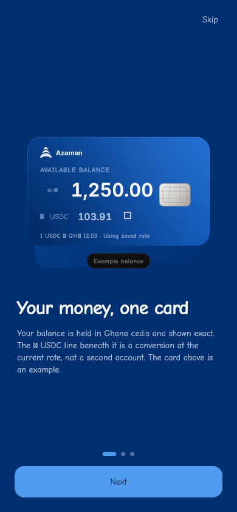
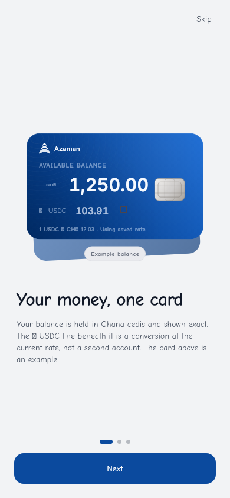
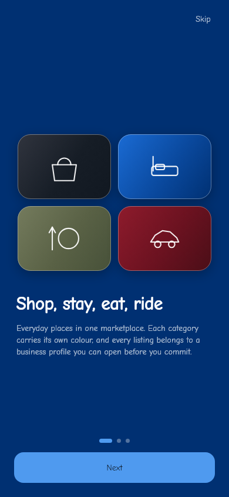
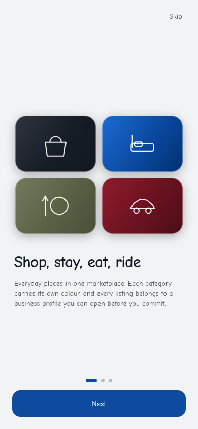

# Public tour — visual review

Six captures, three slides in both appearances, rendered by the capture suite at
390x844 @3x and committed as the golden baselines. These are the images the app
actually draws; they are not mockups.

A golden comparison only proves the rendering is *stable*. This page exists so a
person can judge whether the material is good enough to be Azaman's first
impression, which no assertion can decide.

Measured mean luminance (computed from the committed files, not asserted from
intent) — the appearances are genuinely distinct:

| Slide | Dark | Light | Delta |
|---|---|---|---|
| Wallet | 55.0 | 201.4 | +146.3 |
| Marketplace | 53.7 | 192.4 | +138.7 |
| Community | 49.5 | 226.4 | +176.9 |

`app_intro_slides_golden_test.dart` fails if a light capture is not at least 40
luminance points brighter than its dark twin. That check exists because the tour
once hardcoded the dark palette, so a "light" capture was a byte-identical copy
of the dark one and the evidence was false.

All six shown here use the **Blue** card. A contract test renders Green, Red and
Dark and asserts the wallet hero's card surface carries the applied variant, so
a saved Green card is not silently shown as Blue. These captures are not the
place for that proof: one baseline per appearance keeps the images reviewable.

---

## Slide 1 — Wallet and balance

The user's actual card, drawn by the same `AzamanCardSurface` and the same
on-card ink ladder Home uses, sitting on a depth plate with a pool of the card's
own light behind it. Badged **Example balance**, because a first-run screen must
not imply real money.

| Dark | Light |
|---|---|
|  |  |

## Slide 2 — Shop, Stay, Eat, Ride

Category identity is semantic and fixed: Shop dark, Stay blue, Eat green, Ride
red. Applying a different card must never re-tint these, which is why this slide
ignores the saved variant entirely.

| Dark | Light |
|---|---|
|  |  |

## Slide 3 — Community and Susu

Chat and a Susu ring drawn with type-marks, no invented transactions and no
amounts. Follows the appearance and the card accent without turning semantic
states into brand colours.

| Dark | Light |
|---|---|
|  |  |

---

## How to regenerate deliberately

Never automated. Regeneration is a local act with review after it:

```bash
flutter test --update-goldens test/screens/intro/app_intro_slides_golden_test.dart
cp test/screens/intro/goldens/intro_slide_1_dark.png  docs/intro-slides/wallet-dark.png
# ...and the other five
git status test docs
```

`git status` must list the changed images. An empty list means nothing was
actually copied, and the CI comparison is still running against the old files.
